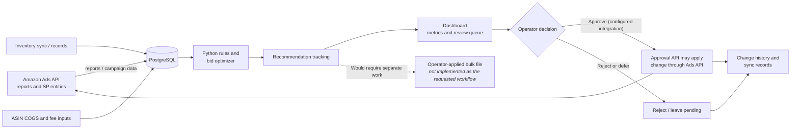

# Amazon Ads Dashboard Demo — Setup & Scope

This repository is a **demo/prototype codebase** for Amazon Ads reporting and optimization workflows. It is useful for exploring the features that are present in the code, but it is **not a completed implementation of a production PPC profit-optimization platform** and has not been validated against any particular company's data or acceptance criteria.

The notes below distinguish current examples from areas that would need additional implementation and validation. Feature presence in the repository does not mean that a workflow is complete, production-ready, or safe to run against a live advertising account.

## What this demo contains

- **Dashboard and API:** A React/Next.js dashboard with a Python/FastAPI backend, PostgreSQL schema, account metrics, campaign and keyword views, financial metrics, inventory views, recommendations, and change-history pages.
- **Rule-based recommendations:** Python rules and bid-optimization code with ACoS/ROAS targets, bid limits, performance safeguards, confidence/reason metadata, and recommendation tracking.
- **Review workflow:** Recommendation review, approval/rejection, and bulk-approval UI/API paths are present.
- **Amazon Ads integration code:** Authentication and API methods for retrieving advertising reports and changing Sponsored Products keyword bids and campaign budgets.
- **Financial and inventory building blocks:** The schema includes per-ASIN COGS and inventory records; the dashboard includes financial calculations and inventory status features.
- **Additional advertising data structures:** Campaign fields and reporting structures include Sponsored Products, Sponsored Brands, and Sponsored Display labels, plus placement reporting tables.

These are demonstrations of code paths and UI surfaces, not evidence that all data sources are connected, populated, reconciled, or operating correctly in a deployed environment.

## How it relates to a larger PPC optimization brief

| Area | Present in this repository | Important boundary |
|---|---|---|
| Sponsored Products optimization | Rule-based ACoS/ROAS recommendations and code for keyword-bid/campaign-budget API updates | This is not a validated profit-maximizing policy or a production-ready controlled pilot. |
| Review and approval | Recommendation review and approval routes/screens | The approval path can call the Amazon Ads API directly when configured. It is not the requested operator-applied bulk-upload-file workflow. |
| Financial analysis | ASIN-level COGS/fee fields and financial dashboard calculations | Family/variation contribution economics are not demonstrated as an input to the bid-decision pipeline. Cost and sales calculations need business validation before use. |
| Inventory | Inventory schema, sync/service code, and dashboard/API surfaces | Inventory freshness, reliability, and enforcement as a hard recommendation safeguard have not been established. |
| Placement and other ad types | Placement reporting structures; Sponsored Brands and Sponsored Display campaign fields | Do not assume complete, read-only coverage or verified recommendations for these ad types. DSP and Sponsored TV coverage are not demonstrated. |
| Operations and controls | Change-history tables, scheduled-service scripts, bid constraints/locks, and sync logging | Current-settings checks, stale-data blocking, duplicate prevention, capped budget reallocation, a system-wide emergency stop, recovery, and scheduled-cycle acceptance are not established as end-to-end controls. |
| Organic and family outcomes | Some ASIN reporting fields include organic/total sales | A workflow that diagnoses organic declines or evaluates variation-family total contribution is not demonstrated. |

Treat the items in the “Important boundary” column as **work to scope and verify**, not as features already delivered. Do not present this demo as meeting an external pilot's timeline or acceptance criteria without a separate implementation and test.

## Demo workflow

The diagram below summarizes the main workflow represented in this repository. It is an architectural overview, not a guarantee that every integration is configured or that data is complete.



In the current demo, the recommendation pipeline is principally rule-based and uses ACoS/ROAS signals. The diagram does not imply variation-family contribution optimization, verified data-freshness checks, or an end-to-end approval/export safety process.

## Demo safety

Use a test environment and non-production credentials when exploring the integration. **Do not approve recommendations or trigger sync/upload operations against a live account unless you have deliberately configured and reviewed the production connection.** The current approval path may apply changes through the Amazon Ads API; the repository does not provide a guaranteed dry-run boundary for every dashboard action.

The dashboard authentication module includes a development fallback JWT secret. Configure a strong `JWT_SECRET_KEY` and review authentication on every API route before any deployment. Do not commit `.env` files, API credentials, database passwords, or real customer/account data.

## Quick start

These commands reflect the shell scripts included in the repository and assume a Bash-compatible environment.

### 1. Configure environment variables

Copy the example files and set local database credentials:

```bash
cp env.example .env
cp dashboard/env.example dashboard/.env
```

Add the Amazon Ads credentials only if you intend to exercise API integration code. Avoid production credentials for a demo.

### 2. Set up the database

Create the PostgreSQL database (the default name is `amazon_ads`) and run:

```bash
./scripts/setup_database.sh
```

The setup script initializes the project's database schemas and checks the connection.

### 3. Install dependencies

```bash
python3 -m venv venv
source venv/bin/activate
pip install -r requirements.txt
pip install -r dashboard/requirements.txt
npm install
cd dashboard/frontend
npm install
cd ../..
```

### 4. Start the application

```bash
./scripts/run.sh
```

Or, where the npm scripts and Bash are available:

```bash
npm run run
```

The runner starts the API on port 8000 and the frontend on port 3000.

## Run services separately

### API

```bash
cd dashboard
python -m uvicorn api.main:app --reload --port 8000
```

### Frontend

```bash
cd dashboard/frontend
npm run dev
```

## Access points

- **Dashboard:** http://localhost:3000
- **API:** http://localhost:8000
- **API documentation:** http://localhost:8000/docs
- **API health check:** http://localhost:8000/api/health

## Troubleshooting

### Database connection issues

- Confirm PostgreSQL is running and the database exists.
- Check database settings in `.env` and `dashboard/.env`.
- Test connectivity with `psql -h localhost -U postgres -d amazon_ads`.

### Port already in use

- API default: `8000`
- Frontend default: `3000`
- Update the relevant service command/configuration for your local environment.

### Missing dependencies

- Python: `pip install -r requirements.txt` and `pip install -r dashboard/requirements.txt`
- Node.js: run `npm install` in the repository root and in `dashboard/frontend`

## Scripts reference

- `scripts/setup_database.sh` — initialize the database schema
- `scripts/run.sh` — start the API and frontend together
- `scripts/quick_start.sh` — convenience startup script
- `scripts/manage_ai.sh` — wrapper for AI system management commands

For production deployment, live-account operation, data quality, financial methodology, and safety controls, perform a separate engineering review and implement and test the missing requirements first.
